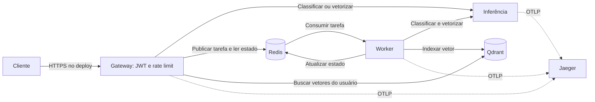

# Plataforma de IA como Serviço — C3.A2

Projeto integrador de Sistemas Distribuídos e Computação em Nuvem · Prof. Howard Cruz Roatti.

- **Equipe:** [preencher com os três nomes]
- **URL pública HTTPS:** <https://ia.arthurssrichard.com>
- **Contato do grupo:** [preencher com e-mail autorizado pela equipe]

Baseada no [kit C3.A2 do professor](https://github.com/howardroatti/sd-2026-2-kit-c3a2). A inferência de demonstração usa scikit-learn e um corpus sintético em português. O artefato é gerado no build; o serviço roda sem GPU, chave ou API de IA externa.

## Arquitetura



- **`POST /predict`** faz inferência síncrona. Se o serviço falhar, retorna `202` com uma tarefa na fila, desde que o Redis esteja disponível.
- **`POST /tarefas`** retorna `202` e o caminho de consulta. Em **`GET /tarefas/{id}`**, `202` significa pendente, `200` contém `concluido` ou `falhou`, e `404` indica tarefa inexistente, expirada ou de outro usuário.
- **`POST /memoria/busca`** recebe `{"texto":"consulta","k":3}` e busca vetores de tarefas concluídas do próprio usuário.

## Executar do zero

Na raiz de um clone, com Docker Engine/Desktop e o plugin Compose:

```bash
docker compose up --build --wait
python3 scripts/fumaca.py
```

O build inicial baixa imagens e dependências. O gateway fica em <http://localhost:8000>, com Swagger em [/docs](http://localhost:8000/docs). O teste de fumaça usa `aluno:aluno123` no modo local e verifica autenticação, classificação, fila, resultado e o vetor da tarefa. Para ajustar configurações locais, copie `.env.example` para `.env`. As credenciais locais são apenas para testes.

Exemplo no terminal (requer `curl` e `python3`):

```bash
TOKEN=$(curl -fsS http://localhost:8000/login \
  -H 'Content-Type: application/json' \
  -d '{"usuario":"aluno","senha":"aluno123"}' \
  | python3 -c 'import json,sys; print(json.load(sys.stdin)["token"])')

curl -fsS http://localhost:8000/predict \
  -H "Authorization: Bearer $TOKEN" -H 'Content-Type: application/json' \
  -d '{"texto":"o atendimento foi excelente"}'
```

## Resiliência e rastreamento

- Gateway e worker usam timeout de 2 s por chamada de inferência, até três tentativas e backoff exponencial com jitter. Cada processo abre seu circuito após três falhas consecutivas durante 10 s; depois permite uma única tentativa de sondagem. Redis e Qdrant também têm timeouts.
- O worker reentrega falhas com espera progressiva, até três reentregas por padrão. Uma tarefa concluída tem o vetor gravado antes de o resultado ser marcado como pronto.
- Para demonstrar o fallback, obtenha um JWT, rode `docker compose stop inferencia`, chame `/predict` e observe o `202`. Rode `docker compose start inferencia` e consulte a tarefa. Reinicie a inferência antes de esgotar as reentregas.
- No [Jaeger](http://localhost:16686), selecione `gateway` e a operação `fila.publicar`. Abra um trace do teste de fumaça: o cabeçalho W3C da fila liga a publicação ao span `worker.processar_tarefa` e às chamadas de inferência do worker. Para verificar automaticamente, rode `JAEGER_URL=http://localhost:16686 python3 scripts/fumaca.py`.
- [Prometheus](http://localhost:9090) e [Grafana](http://localhost:3000) são locais. O recomendador informa a escala; no Compose, escalar o worker é manual (`docker compose up -d --scale worker=2`).

## Segurança e LGPD

O gateway valida JWT com expiração, limita requisições por conta e limita tentativas de login por IP. No deploy documentado, Caddy termina HTTPS e só encaminha tráfego ao gateway. Redis, Qdrant e inferência não têm portas no host. Painéis e métricas são para operação local. As configurações e segredos de deploy ficam fora do Git; use somente textos fictícios na demonstração.

| Dados tratados | Finalidade | Retenção |
|---|---|---|
| Nome de usuário e senha | Autenticar contas de demonstração | Até a remoção da configuração; o token expira em 120 minutos por padrão. |
| Indicadores derivados de conta/IP | Aplicar rate limit | Até 70 s no Redis. |
| Texto e consulta | Classificar, vetorizar e buscar | Requisições síncronas são processadas em memória. O texto de tarefa é removido no término ou expira no Redis após 1 h por padrão. |
| Identificador, conta, resultado e vetor | Consultar a tarefa e localizar resultados semelhantes | 1 h a partir da criação por padrão; a busca exclui vetores expirados imediatamente. O worker tenta removê-los do Qdrant a cada minuto enquanto estiver operacional. A expiração lógica não implica eliminação física imediata do disco. |
| Rotas, tempos, códigos HTTP e ID técnico de tarefa | Diagnóstico e rastreamento | Jaeger usa memória; logs têm rotação no Compose. |

Os textos não são enviados a provedores de IA, usados em treinamento ou incluídos intencionalmente nos logs. Solicitações sobre dados podem ser enviadas ao contato do grupo indicado acima.

## Deploy e entrega

Veja [publicação HTTPS e colaboração no GitHub](deploy/INSTRUCOES.md), o [relatório de CAP, custo e latência](docs/TRADE-OFFS.md) e o [checklist de entrega](docs/STATUS.md).

O núcleo está em `gateway/`, `inferencia/`, `worker/` e `comum/`. O Compose usa imagens oficiais para Redis, Qdrant e observabilidade. Os exemplos opcionais em `k8s/` e `edge/` não são necessários para o deploy. A automação em `.github/workflows/ci.yml` testa em containers. Para habilitar a publicação opcional no GHCR, vá em **Settings → Secrets and variables → Actions → Variables** e crie a variável `PUBLICAR_GHCR` com valor `true`. Publicar imagens não cria a URL da aplicação.

Licença MIT, herdada do kit.
